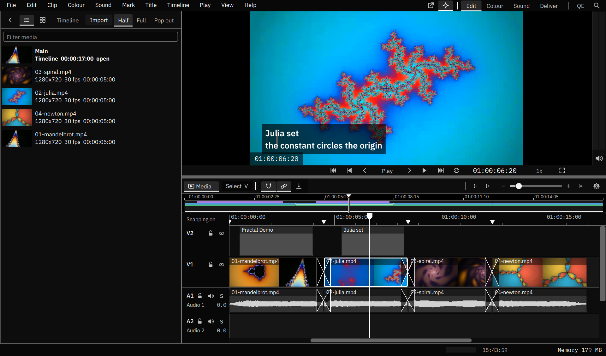
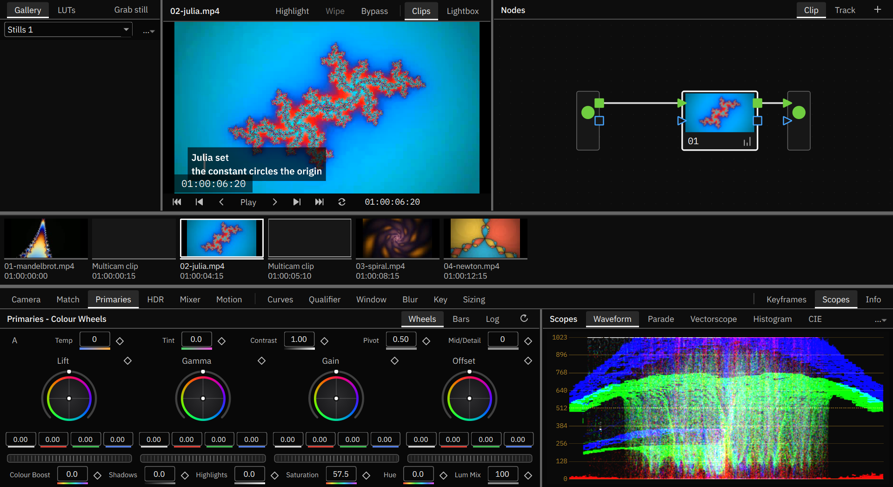
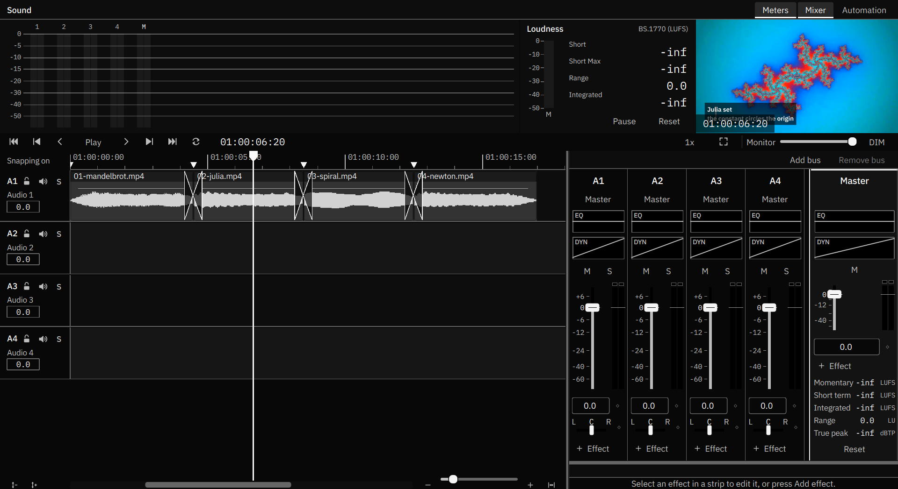

# Chopper

A light, fast video editor for Windows, built for low-end laptops. Chopper edits small proxies of 4K camera and multicam footage, so cutting, trimming, audio sync and multicam switching stay smooth in under 2 GB of memory. When the edit is done it either finishes in Chopper (colour, sound and Deliver pages) or exports a timeline that DaVinci Resolve opens with the edit already applied, pointing at your original full-quality files.

## Download

[Chopper-Setup.exe](https://github.com/tarolys/chopper-dist/releases/download/latest/Chopper-Setup.exe) installs Chopper for your user account. No administrator rights needed. Windows 10 or 11, 64-bit.

[Chopper-Update.exe](https://github.com/tarolys/chopper-dist/releases/download/latest/Chopper-Update.exe) updates an existing install in place and only replaces the files that changed.

Windows may show a SmartScreen warning because the programs are not code signed. Choose More info, then Run anyway.

Older versions stay on the [releases page](https://github.com/tarolys/chopper-dist/releases), one release per version.

## Notes

Chopper is vibe coded with Claude Sonnet and Opus. Feedback and issues are welcome. There is no guarantee of stability or reliability, and the Stable or Unstable badge above says which of the two the latest build is. Use is covered by the [license](LICENSE).
